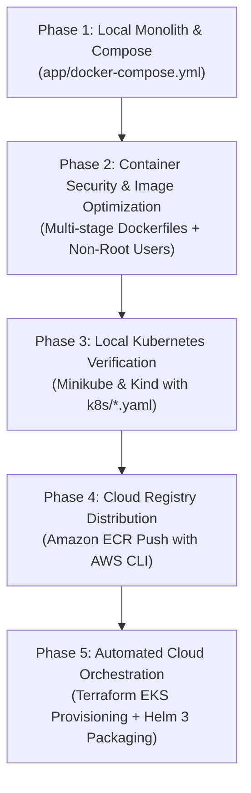

# Kubernetes Migration & Deployment to Amazon EKS

### 🚀 Production-Ready Microservices Migration from Docker Compose to Amazon Elastic Kubernetes Service (EKS)

[](https://kubernetes.io/)
[](https://aws.amazon.com/eks/)
[](https://www.terraform.io/)
[](https://helm.sh/)
[](https://www.docker.com/)
[](https://nodejs.org/)
[](https://react.dev/)
[](https://www.postgresql.org/)
[](LICENSE)

An enterprise-grade cloud migration project demonstrating the end-to-end journey of containerizing, orchestrating, and migrating a full-stack multi-tier application (**DevOps Task Tracker**) from a legacy local **Docker Compose** environment to a secure, resilient, and auto-scaled **Amazon EKS** cloud architecture using **Terraform Infrastructure as Code (IaC)** and **Helm 3**.

---

## 🏛️ System Architecture

```text
                                 [ Global Internet / Developers ]
                                                │
                                                ▼ (HTTPS / DNS)
                                   [ AWS Application Load Balancer ]
                                                │
════════════════════════════════════════════════╪════════════════════════════════════════════════
[ AWS Virtual Private Cloud (VPC: 10.0.0.0/16) ]│
                                                ▼
  ┌─────────────────────────── Amazon EKS Cluster (devops-tracker) ───────────────────────────┐
  │                                                                                          │
  │  [ Ingress Controller / NodePort ]                                                       │
  │                 │                                                                        │
  │                 ▼                                                                        │
  │     [ Frontend Service (ClusterIP: 80) ]                                                 │
  │                 │                                                                        │
  │                 ▼                                                                        │
  │     ┌────────────────────────────────────────────────────────┐                           │
  │     │ Frontend Pod (Nginx + React SPA)                       │                           │
  │     │ ├── Serves compiled UI assets                          │                           │
  │     │ └── Reverse proxies /api requests ──────────────────┐  │                           │
  │     └─────────────────────────────────────────────────────┼──┘                           │
  │                                                           │                              │
  │                                                           ▼                              │
  │                                       [ Backend Service (ClusterIP: 5000) ]              │
  │                                                           │                              │
  │                                                           ▼                              │
  │     ┌────────────────────────────────────────────────────────┐                           │
  │     │ Backend Pod (Node.js Express REST API)                 │                           │
  │     │ ├── Non-root user (UID 1000)                           │                           │
  │     │ ├── Startup, Liveness & Readiness Probes               │                           │
  │     │ ├── ConfigMap: backend-config (NODE_ENV, DB_HOST)      │                           │
  │     │ └── Secret: postgres-secret (DB credentials)           │                           │
  │     └─────────────────────────┬──────────────────────────────┘                           │
  │                               │                                                          │
  │                               ▼                                                          │
  │               [ PostgreSQL Service (ClusterIP: 5432) ]                                   │
  │                               │                                                          │
  │                               ▼                                                          │
  │     ┌────────────────────────────────────────────────────────┐                           │
  │     │ Database Pod (PostgreSQL 16 Alpine)                    │                           │
  │     │ ├── ConfigMap: postgres-init (DDL migrations & seeds)  │                           │
  │     │ └── PVC Mount: /var/lib/postgresql/data ────────────┐  │                           │
  │     └─────────────────────────────────────────────────────┼──┘                           │
  │                                                           │                              │
  └───────────────────────────────────────────────────────────┼──────────────────────────────┘
                                                              │
                                                              ▼
                                            [ AWS EBS Volume (gp3 CSI Storage) ]
```

---

## 🔄 The 5-Phase Migration Journey



---

## 🛠️ Technology Stack Matrix

| Domain | Technology | Purpose & Implementation |
|---|---|---|
| **Cloud Provider** | **AWS (us-east-1)** | VPC, Public/Private Subnets, NAT Gateways, IAM OIDC, ECR, and Amazon EKS. |
| **Container Orchestration** | **Amazon EKS & Minikube** | Multi-node cluster management, self-healing deployments, and service discovery. |
| **Infrastructure as Code** | **Terraform** | Declarative cloud resource provisioning (VPC, Security Groups, IAM, and EKS managed node groups). |
| **Package Management** | **Helm 3** | Reusable templated packaging (`app/helm/devops-task-tracker`) with environment-specific overrides. |
| **Container Engine** | **Docker & Buildx** | Multi-stage, minimal Alpine base images with non-root security context (`USER node`). |
| **Container Registry** | **Amazon ECR** | Secure, private container registry for distribution to AWS EKS worker nodes. |
| **Application Layer** | **Node.js, Express, React, Vite** | Modern full-stack REST application with JWT authentication, Kanban dashboard, and health probes. |
| **Database & Storage** | **PostgreSQL 16 & AWS EBS CSI** | Persistent stateful workload backed by Kubernetes PVCs and automated migration jobs. |
| **Observability** | **Kubernetes Probes & Prometheus** | Startup, liveness, and readiness probes (`/api/health/live`, `/api/health/ready`). |

---

## 📂 Repository Directory Structure

```text
Kubernetes-Migration-Deployment-to-Amazon-EKS/
├── .gitignore                          # Excludes secrets, node_modules, and container tarballs
├── README.md                           # Master project documentation
│
├── app/                                # DevOps Task Tracker Application Stack
│   ├── backend/                        # Node.js + Express REST API
│   │   ├── src/                        # Controllers, routes, models, and DB migrations
│   │   ├── Dockerfile                  # Production Alpine container with non-root user
│   │   ├── .env.example                # Sample backend environment configuration
│   │   └── package.json                # Dependencies and Jest testing scripts
│   │
│   ├── frontend/                       # React 18 + Vite + Tailwind CSS Client
│   │   ├── src/                        # Components, pages, and API client
│   │   ├── nginx.conf                  # Nginx reverse proxy configuration (/api -> backend:5000)
│   │   ├── Dockerfile                  # Multi-stage production Nginx container
│   │   └── .env.example                # Frontend environment template
│   │
│   ├── k8s/                            # Pure Kubernetes Manifests (Declarative YAML)
│   │   ├── backend.yaml                # Backend Deployment & ClusterIP Service
│   │   ├── backend-configmap.yaml      # Non-sensitive backend environment variables
│   │   ├── frontend.yaml               # Frontend Deployment & Service
│   │   ├── postgres.yaml               # PostgreSQL Deployment, Secret, PVC, and Service
│   │   └── db-migration-job.yaml       # One-shot database schema migration Job
│   │
│   ├── helm/                           # Helm 3 Application Packaging
│   │   └── devops-task-tracker/        # Chart containing configurable templates and values
│   │       ├── Chart.yaml              # Chart metadata
│   │       ├── values.yaml             # Configurable values (images, replicas, ports, storage)
│   │       └── templates/              # Kubernetes resource templates
│   │
│   ├── docker-compose.yml              # Legacy local multi-container development environment
│   └── .env.example                    # Global environment template for Docker Compose
│
├── terraform/                          # Infrastructure as Code (AWS Cloud Provisioning)
│   ├── main.tf                         # Master Terraform configuration
│   ├── providers.tf                    # AWS and Kubernetes provider definitions
│   ├── variables.tf                    # VPC CIDRs, cluster names, and node sizing
│   ├── outputs.tf                      # EKS cluster endpoint, OIDC ARN, and kubeconfig string
│   └── modules/                        # Reusable VPC, IAM, and EKS cluster modules
│
├── docs/                               # Architecture Specifications & API Reference
│   ├── api-documentation.md            # Complete REST API documentation with endpoints
│   ├── architecture.md                 # Deep-dive architectural decisions
│   └── migration-guide.md              # Docker Compose to EKS migration strategy
│
└── learning/                           # Comprehensive Step-by-Step Practical Guides
    ├── 01-deploy-postgres-container-in-minikube.md  # Step 1: Stateful DB deployment in K8s
    ├── 02-deploy-frontend-container-in-minikube.md  # Step 2: Nginx + React deployment in K8s
    ├── 03-deploy-backend-container-in-minikube.md   # Step 3: Express API deployment in K8s
    ├── 04-push-images-to-amazon-ecr.md              # Step 4: Tagging and pushing images to AWS ECR
    ├── kubectl-pods-and-services-inspection.md      # Pod lifecycle, services, and debugging
    ├── kubectl-port-forward-guide.md                # Port forwarding and local tunneling
    └── environment-variables-reference.md           # Consolidated reference of all env configs
```

---

## 🚀 Execution & Deployment Guide

### Phase 1: Local Verification with Docker Compose (Legacy Baseline)
Run the full-stack application locally before migration:

```bash
cd app
cp .env.example .env
docker compose up -d
```
* **Frontend:** `http://localhost:3000`
* **Backend API:** `http://localhost:5001/api/health`
* **Shutdown:** `docker compose down`

---

### Phase 2: Local Kubernetes Testing (Minikube / Kind)

1. **Start your local cluster:**
   ```bash
   minikube start --driver=docker
   ```

2. **Build and load local images into the cluster:**
   ```bash
   docker build -t app-backend:latest app/backend
   docker build -t app-frontend:latest app/frontend

   minikube image load app-backend:latest
   minikube image load app-frontend:latest
   ```

3. **Deploy manifests:**
   ```bash
   kubectl apply -f app/k8s/postgres.yaml
   kubectl apply -f app/k8s/backend-configmap.yaml
   kubectl apply -f app/k8s/backend.yaml
   kubectl apply -f app/k8s/frontend.yaml
   ```

4. **Verify rollout health:**
   ```bash
   kubectl rollout status deployment/backend -n devops-tracker --timeout=180s
   kubectl rollout status deployment/frontend -n devops-tracker --timeout=180s
   ```

5. **Access the application locally:**
   ```bash
   kubectl port-forward -n devops-tracker service/frontend 3000:80
   ```
   Navigate to `http://localhost:3000` in your browser.

---

### Phase 3: Push Images to Amazon ECR

Authenticate your local Docker engine with Amazon ECR and publish the images:

```bash
# 1. Login to ECR
aws ecr get-login-password --region us-east-1 --profile eks-devops | \
  docker login --username AWS --password-stdin <AWS_ACCOUNT_ID>.dkr.ecr.us-east-1.amazonaws.com

# 2. Tag images
docker tag app-backend:latest <AWS_ACCOUNT_ID>.dkr.ecr.us-east-1.amazonaws.com/devops-tracker-backend:latest
docker tag app-frontend:latest <AWS_ACCOUNT_ID>.dkr.ecr.us-east-1.amazonaws.com/devops-tracker-frontend:latest

# 3. Push to ECR
docker push <AWS_ACCOUNT_ID>.dkr.ecr.us-east-1.amazonaws.com/devops-tracker-backend:latest
docker push <AWS_ACCOUNT_ID>.dkr.ecr.us-east-1.amazonaws.com/devops-tracker-frontend:latest
```

---

### Phase 4: Deploy Using Helm 3

Deploy the entire microservice ecosystem using the packaged Helm chart:

```bash
cd app/helm/devops-task-tracker

# 1. Lint the Helm chart templates
helm lint .

# 2. Dry-run template generation
helm install devops-task-tracker . --dry-run --debug

# 3. Deploy to your Kubernetes cluster
helm install devops-task-tracker . \
  --namespace devops-tracker \
  --create-namespace \
  --set postgres.auth.password="supersecretpassword"
```

---

### Phase 5: Cloud Infrastructure with Terraform (Amazon EKS)

Provision the production cloud infrastructure on AWS:

```bash
cd terraform
terraform init
terraform plan -out=tfplan
terraform apply tfplan
```

Update your local kubeconfig to authenticate with the new AWS EKS cluster:
```bash
aws eks update-kubeconfig --region us-east-1 --name devops-tracker-eks
kubectl get nodes
```

---

## 🔒 Security & Production Hardening

* **Non-Root Execution:** All application containers drop root privileges (`USER node`, UID 1000) and enforce `runAsNonRoot: true`.
* **Privilege Escalation:** Containers strictly set `allowPrivilegeEscalation: false` and drop all Linux capabilities (`capabilities.drop: ["ALL"]`).
* **Secret Isolation:** Database passwords and sensitive tokens are injected exclusively via Kubernetes Secrets (`secretKeyRef`) or AWS Secrets Manager.
* **Network Policies & Segmentation:** Microservices communicate over private `ClusterIP` networks; database port `5432` is never exposed externally.
* **Storage Encryption:** Persistent volumes in AWS are backed by EBS volumes encrypted at rest with AWS KMS.

---

## 📖 Deep-Dive Learning & Reference Guides

Comprehensive step-by-step documentation created throughout this project:

| Guide | Description |
|---|---|
| [**01 - PostgreSQL in Minikube**](learning/01-deploy-postgres-container-in-minikube.md) | PVC creation, SQL init configmaps, and stateful database verification. |
| [**02 - Frontend in Minikube**](learning/02-deploy-frontend-container-in-minikube.md) | React image loading, Nginx reverse proxy routing, and NodePort access. |
| [**03 - Backend in Minikube**](learning/03-deploy-backend-container-in-minikube.md) | Probes, database connectivity, and non-root runtime verification. |
| [**04 - Pushing Images to ECR**](learning/04-push-images-to-amazon-ecr.md) | ECR authentication, repository tagging, and image publishing. |
| [**Kubectl Inspection Commands**](learning/kubectl-pods-and-services-inspection.md) | Pod states, rollout monitoring, and 3-in-1 snapshot debugging. |
| [**Kubectl Port-Forwarding Guide**](learning/kubectl-port-forward-guide.md) | Secure local tunneling to private Kubernetes ClusterIP services. |
| [**Environment Variables Reference**](learning/environment-variables-reference.md) | Complete reference of all `.env`, ConfigMap, and Secret values. |
| [**REST API Documentation**](docs/api-documentation.md) | Complete endpoints, request/response payloads, and authentication headers. |

---

## 📄 License
This project is open-source under the [MIT License](LICENSE).
