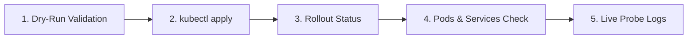

# Backend Deployment and Verification in Minikube

## Overview

This guide documents the end-to-end workflow for deploying the **DevOps Task Tracker Backend** service to a local Minikube cluster using Kubernetes manifests (`k8s/backend.yaml`). It covers client-side validation, resource application, rollout monitoring, service status, and pod log inspection.

---

## Deployment & Verification Workflow



---

## 1. Client-Side Dry-Run Validation

Before sending manifests to the cluster, validate YAML syntax and schema locally:

```bash
kubectl apply --dry-run=client -f k8s/backend.yaml
```

### Output:
```text
deployment.apps/backend created (dry run)
service/backend created (dry run)
```

> **Why this matters:** `--dry-run=client` catches syntax errors, unclosed strings, or invalid Kubernetes API fields on your local machine without creating any actual resources or modifying cluster state.

---

## 2. Apply Manifests to the Cluster

Deploy the Backend `Deployment` and `Service` resources into the `devops-tracker` namespace:

```bash
kubectl apply -f k8s/backend.yaml
```

### Output:
```text
deployment.apps/backend created
service/backend created
```

---

## 3. Monitor Rollout Progress

Wait for the deployment rollout to complete and confirm all containers pass health checks:

```bash
kubectl rollout status deployment/backend \
  -n devops-tracker \
  --timeout=180s
```

### Output:
```text
deployment "backend" successfully rolled out
```

* **Timeout Protection:** If the image cannot be pulled (`ErrImagePull`) or probes fail, the command exits with code `1` after 180 seconds.
* **Success Indicator:** Indicates all requested replicas (`1/1`) are running, ready, and receiving traffic.

---

## 4. Verify Pods and Services

### A. Check Pod Status
```bash
kubectl get pods -n devops-tracker
```

### Output:
```text
NAME                        READY   STATUS    RESTARTS   AGE
backend-788f4b7895-7qttk    1/1     Running   0          15s
postgres-599587dc4b-6bj6q   1/1     Running   0          79m
```

* **`READY 1/1`**: The container has passed its `readinessProbe` on `/api/health/ready`.
* **`RESTARTS 0`**: No crashes or probe-induced container restarts.

---

### B. Check Service Endpoints
```bash
kubectl get svc -n devops-tracker
```

### Output:
```text
NAME       TYPE        CLUSTER-IP      EXTERNAL-IP   PORT(S)    AGE
backend    ClusterIP   10.97.113.89    <none>        5000/TCP   30s
postgres   ClusterIP   10.106.205.22   <none>        5432/TCP   79m
```

* **`backend` (ClusterIP `10.97.113.89:5000`)**: Accessible internally by frontend pods or ingress controllers via the DNS name `http://backend:5000`.
* **`postgres` (ClusterIP `10.106.205.22:5432`)**: Database service accessed by the backend via `DB_HOST=postgres` and `DB_PORT=5432`.

---

## 5. Inspect Application and Probe Logs

View runtime application startup logs and Kubernetes health probe requests:

```bash
kubectl logs deployment/backend -n devops-tracker
```

### Output:
```text
[Server] DevOps Task Tracker Backend running on port 5000
[Server] Environment: production
[Server] Health Check available at http://localhost:5000/api/health
10.244.0.1 - - [23/Oct/2026:17:30:17 +0000] "GET /api/health/live HTTP/1.1" 200 54 "-" "kube-probe/1.37"
10.244.0.1 - - [23/Oct/2026:17:30:17 +0000] "GET /api/health/ready HTTP/1.1" 200 80 "-" "kube-probe/1.37"
10.244.0.1 - - [23/Oct/2026:17:30:22 +0000] "GET /api/health/live HTTP/1.1" 200 54 "-" "kube-probe/1.37"
10.244.0.1 - - [23/Oct/2026:17:30:22 +0000] "GET /api/health/ready HTTP/1.1" 200 80 "-" "kube-probe/1.37"
10.244.0.1 - - [23/Oct/2026:17:30:27 +0000] "GET /api/health/ready HTTP/1.1" 200 80 "-" "kube-probe/1.37"
10.244.0.1 - - [23/Oct/2026:17:30:32 +0000] "GET /api/health/live HTTP/1.1" 200 54 "-" "kube-probe/1.37"
10.244.0.1 - - [23/Oct/2026:17:30:32 +0000] "GET /api/health/ready HTTP/1.1" 200 80 "-" "kube-probe/1.37"
```

---

## Key Observations from Probe Logs

1. **User-Agent `kube-probe/1.37`**: Requests originate from the Kubelet agent on the node (`10.244.0.1`), not an external user.
2. **HTTP `200` Responses**: Both health endpoints return status code `200`:
   - `/api/health/live` (Liveness Probe): Informs Kubelet that the process is responsive.
   - `/api/health/ready` (Readiness Probe): Informs Kubelet that database connectivity is established and the pod can receive traffic.
3. **Execution Interval**:
   - `/api/health/ready` runs every **5 seconds** (`periodSeconds: 5`).
   - `/api/health/live` runs every **10 seconds** (`periodSeconds: 10`).

---

## Summary of Configured Backend Architecture

| Setting | Value in Manifest | Purpose |
|---|---|---|
| **Image** | `app-backend:latest` | Pre-built container image loaded in Minikube |
| **Pull Policy** | `IfNotPresent` | Uses local image without attempting remote registry pull |
| **Database Host** | `postgres` | Resolved through Kubernetes internal ClusterIP service DNS |
| **Database User & Pass** | `secretKeyRef: db-credentials` | Injected securely from Secret without plain text in YAML |
| **CPU Requests / Limits** | `100m` / `500m` | Guaranteed minimum 0.1 vCPU, capped at 0.5 vCPU |
| **Memory Requests / Limits** | `128Mi` / `512Mi` | Guaranteed minimum 128 MB RAM, capped at 512 MB |
